# Design Justification

The rule we used to decide almost everything: does this bring the user closer to the book, or keep them longer on the phone? The app is made to be used very little.

Screenshots are from the final app (the same screens on the iPhone and the web version).

## 1. Cognitive load (cognition)
Working memory is limited, so we try to ask for one thing at a time.
- Onboarding asks for one thing per screen ("Step 3 of 7") instead of a long form.
- In the check-in you type the page you are on, not how many you read. You see that number in the book and you don't have to subtract; the app works out the "+18 pages".
- Quick buttons for "+10", "+20" and "Finished the chapter".
- The quiz shows one question at a time.

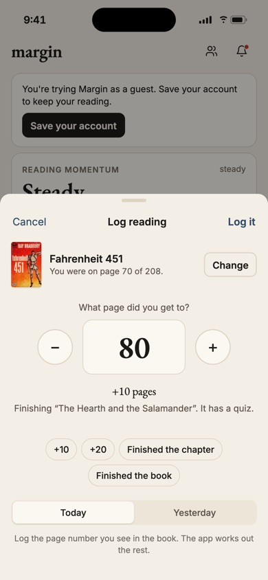

## 2. Feedback
The user should always know what happened (Nielsen's heuristic 1).
- If the page is not valid, the field turns red and says why before you submit.
- In the quiz, the right answer is marked green and the wrong one red, and it also says "Exactly." or "Not quite." with an explanation, so it doesn't rely on color alone.
- At the end of the check-in: "+18 pages today · Reading momentum: from Steady to Strong".

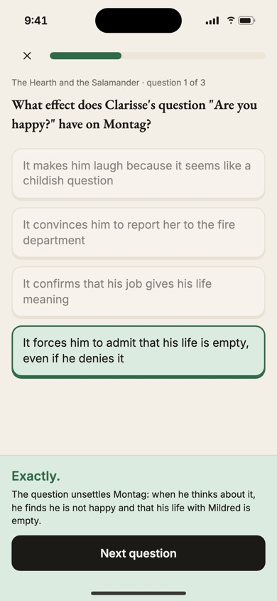

## 3. Error prevention and constraints
Better to prevent the error than to explain it later (Norman; Nielsen 5).
- It doesn't let you log a page lower than the one you were on, higher than the book's total, or more than 400 pages at once (`ReadingService.Validate`, with tests).
- The keyboard only accepts numbers.
- You can't finish onboarding without picking at least one day.
- "Delete all my data" asks for confirmation.
- Different editions. We noticed that each publisher paginates differently, so the quiz could show up in the middle of a chapter. Now we ask how many pages your edition has and recalculate where each chapter ends (`Edition.cs`, with tests). Since it is still an estimate, before the quiz the app asks "Did you finish "…"?" instead of assuming it.

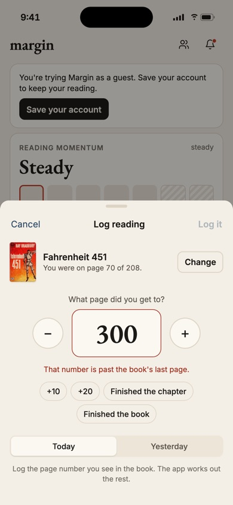 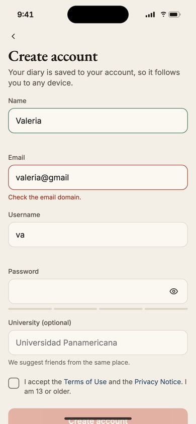

## 4. Habit formation (psychology)
- Fogg (B = MAP): the suggested goal is small (5 to 15 pages) so it is easy, and the reminder arrives at the time you picked.
- Implementation intentions (Gollwitzer): onboarding asks you to complete "When ___, I will read".
- Lally (2010): one missed day doesn't break a habit. That's why there is no streak but a reading momentum: `M = 0.85·M_previous + 0.15·min(pages/goal, 1.5)`. If you don't read one day it drops about 15 %, it doesn't go to zero. The rest days you picked don't count, and the 1.5 cap stops 200 pages in one day from counting like a whole week.
- Testing effect (Roediger and Karpicke): the quiz at the end of a chapter helps you remember. It is optional.

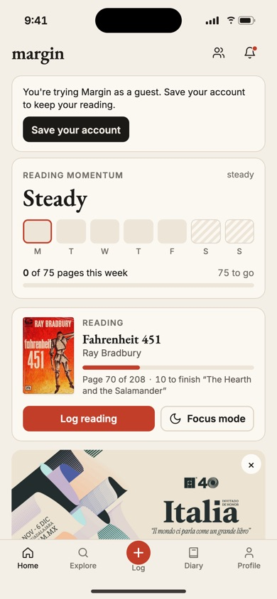

## 5. Ethical design
We didn't want guilt or aggressive notifications.
- At most 4 reminders per week; if you ignore 3 in a row, they are cut in half, and they never arrive if you already read that day (`ReminderPlanner.cs`).
- There is no infinite feed. The tabs are Home, Explore, Log, Library and Profile, and the friends' activity on Home is a short list that ends.
- At the end of the check-in you only see the pages you added and your momentum, and a "Done" button. Before, this screen said "Now close the app and go read" and offered "Keep reading in Focus mode". We took both out: when you log, your reading session is already over, so telling you to go read (or to read more) didn't make sense.

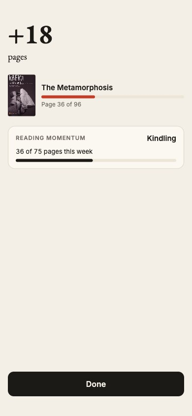

## 6. Transparent AI
- Each quiz says the questions were made with AI and reviewed by people.
- The reflection has no autocomplete and carries the "Written by a human" stamp.
- Recommendations say why they appear ("Shares themes with Fahrenheit 451").

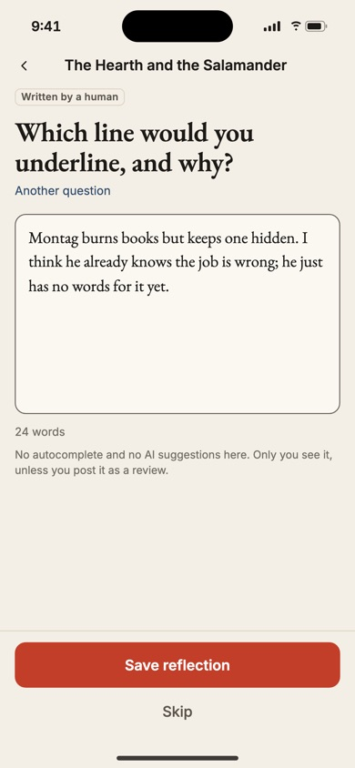

## 7. Perception and consistency
- All colors and sizes come from one file (`app.uss`, the same tokens as the web's `app.css`) and the components from `Components.cs`, so everything looks the same, on the phone and on the web.
- Serif (EB Garamond) for what you read and sans (Inter) for what you use.
- A single accent color (red) for the main action, and one main action per screen.
- Contrast: we measured it with the WCAG formula. The minimum for normal text is 4.5:1.

| Text / background | Light | Dark |
|---|---|---|
| Main text | 15.16:1 | 14.94:1 |
| Secondary text | 6.44:1 | 8.45:1 |
| Gray text (labels, tabs) | 4.55:1 | 4.55:1 |
| Main button | 5.23:1 | 5.50:1 |
| Error | 6.55:1 | — |

  When we measured, we saw that the label gray (3.19:1) and the red used as small text (4.34:1) did not pass. We darkened them a bit (`#716C63` and `#C23E29`) and now they pass.

## 8. iPhone
- Buttons from 44 to 56 pt, as Apple's guidelines ask.
- It respects the notch and the bottom bar (safe area).
- Tab bar at the bottom and a "‹" button to go back, like in native apps.
- Number keyboard for pages and swiping in the manifesto.
- In Focus mode you pick the apps to silence by their real name and icon (WhatsApp, Instagram, TikTok and others), so you recognize them instead of reading a list.
- Local notifications.
- Large text option in Settings and dark mode in Focus mode.
- App silencing is a simulation of Screen Time; the real version would use FamilyControls, which needs permission from Apple.

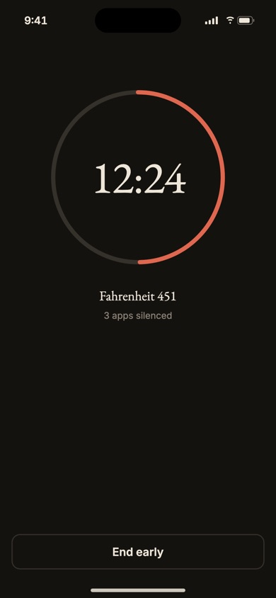

## 9. Friends and accountability
Telling someone what you plan to do makes you more likely to do it. We wanted that help from friends without turning reading into a contest.
- Social support: a friend can see your current book and page, your momentum and the books you finished. That is enough for "how is it going?".
- "Read a book together": two friends pick the same book and both see each other's progress on Home. It works like a small shared pact.
- No rankings, no likes, no "you are behind your friend". Momentum is shown as a level, not a number to beat.
- Empty state with a reason: "No friends yet. Invite someone: reading is easier when someone asks you how it's going."

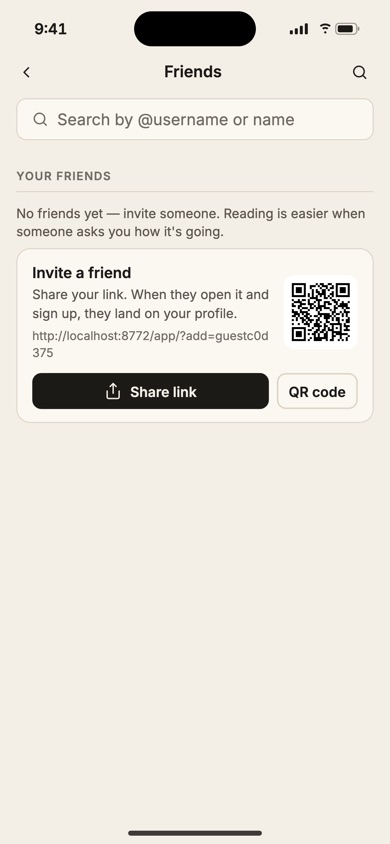

## 10. Recognition over recall (finding friends)
Nielsen's heuristic 6: it is easier to recognize than to remember.
- You can search by name, not only by the exact @username, and each result shows the avatar, name and @username.
- Suggestions from your own university, so you recognize people instead of typing names.
- The invite link already has your username inside (`?add=username`) and has a copy button. Your friend only opens it.

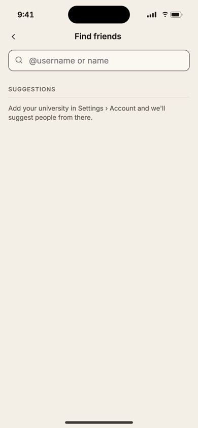

## 11. Feedback in requests
- After you send a request the button changes to show it is pending, and you can cancel it.
- Incoming requests show up on the Friends screen and in notifications, and the friends button on Home shows a dot while some are waiting. The app also tells you when someone accepted your request.
- While you sign up, the app checks if the @username is free before you submit.

## 12. Constraints on what people can post
- Creators can post a list, a short text or a video, and videos are only YouTube links (`PostRules.cs`). The video is never autoplayed.
- Posts have no like counts, and the feed has an end. We did not want another app to scroll.

## 13. Getting the book on paper (mapping)
The goal is reading on paper, so the Book screen ends with "Buy it".
- Real prices from Librerías Gandhi, only printed books, with the lowest one first. The price is the real one, not an estimate, and it says when it was updated.
- Links to search the same book in Amazon México and El Sótano, using the Spanish title so the search works.
- It says that Margin earns nothing from these links.
- The FIL Guadalajara banner on Home links to the real fair. You can close it and it disappears after the fair ends.

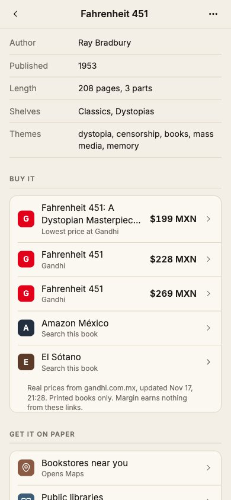

## 14. Guest mode (lowering the entry cost)
Fogg (B = MAP): if something is hard to start, fewer people try it. An account form on the first screen is a cost.
- "Try it without an account" lets you start reading right away.
- Later, "Save your account" adds an email and a password to the same account, so you don't lose what you logged.

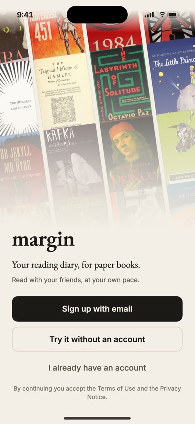

## 15. Privacy
- The diary (logs, quizzes, reflections) is private. Only you can read it; every table has row level security.
- Friends only see a short public summary. You can hide your current book and set your activity to "Only me".
- Reflections are never shared and we don't use your writing to train any AI.

## 16. Starting and finishing a book (feedback and motivation)
Starting a book is a big decision, so we gave it its own moment instead of a small toast.
- "Start reading" is the main button (in the accent color) on a book page when you are not reading anything. If you are already reading another book, the main button stays "Want to read", so you don't replace your book by accident.
- Before you start, a screen shows the length, about how many weeks it will take at your pace and today's goal. When you confirm there is a little confetti and you go back to Home to log your reading.
- When you finish a book you see the achievements you unlocked, you can rate it, post a review or share it.
- "Find your next book" asks five questions and also learns from what you read and rated (`NextBook.cs`). Every result says why it was picked, so it is not a black box.

## Summary: where each decision comes from
| Decision | Why | File |
|---|---|---|
| Momentum instead of a streak | Lally: missing a day doesn't break the habit | `HabitEngine.cs` |
| Small goal and "When ___, I will read" | Fogg, Gollwitzer | `SetupScreen` in `AuthScreens.cs` |
| Log the page, not the amount | Cognitive load (tested with the A/B) | `LogSheet` in `BookFlowScreens.cs` |
| Page validation | Error prevention | `ReadingService.cs` |
| Optional quiz with explanation | Testing effect, feedback | `QuizScreen` in `BookFlowScreens.cs` |
| At most 4 reminders | Ethical design | `ReminderPlanner.cs` |
| "Written by a human" stamp | Students worry that using AI makes them stop thinking | `ReflectionScreen` in `BookFlowScreens.cs` |
| Short end of session, just "Done" | The session is already over, no extra time in the app | `ClosingScreen` in `BookFlowScreens.cs` |
| Friends see progress, no rankings | Social support without guilt | `SocialGraph.cs`, `ProfileSummary.cs` |
| Search by name and invite link | Recognition over recall | `FindFriendsScreen` in `SettingsSocialScreens.cs`, `InviteLink.cs` |
| Only lists, texts and YouTube links | Constraints, no infinite feed | `PostRules.cs` |
| "Buy it" with real prices | Mapping to the real goal: a paper book | `Commerce.cs`, `Shop` in `MainScreens.cs` |
| A screen to start a book, achievements at the end | Feedback, motivation | `StartBookScreen`, `FinishedScreen` in `BookFlowScreens.cs` |
| Guest mode | Fogg: lower the cost to start | `WelcomeScreen` in `AuthScreens.cs`, `AccountService.cs` |

What we changed because of the interviews and tests is in [UserResearch.md](UserResearch.md) and [UserTesting.md](UserTesting.md).
