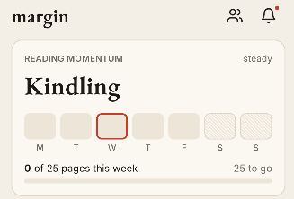
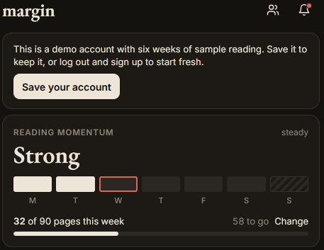
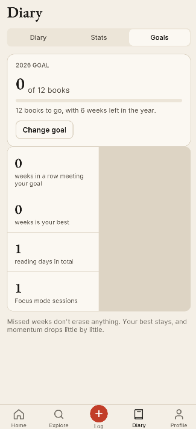
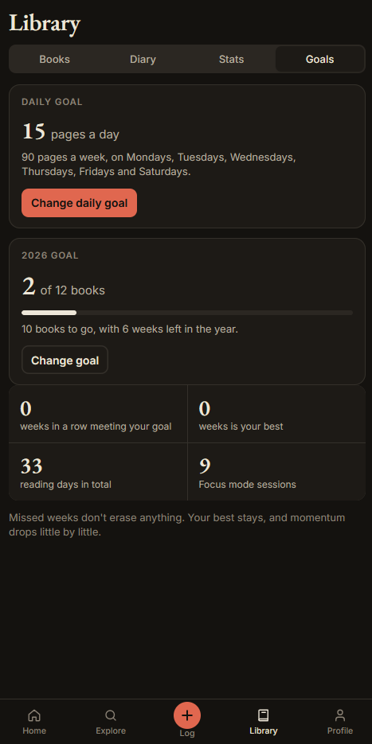
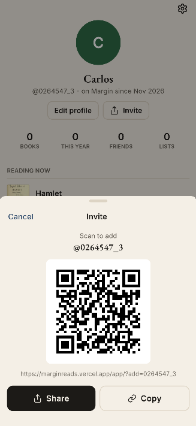
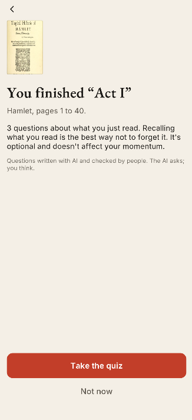
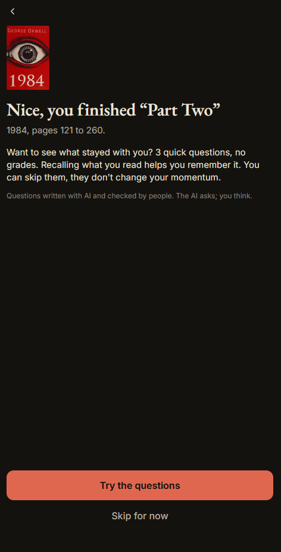
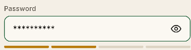
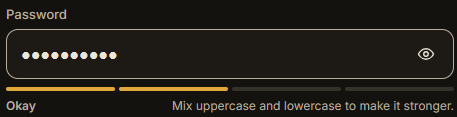

# User Testing

## Who tested
6 university students aged 19 to 25 who did not take part in the interviews. Sessions were on 17 November 2026. They tested the web version of Margin (marginreads.vercel.app/app), which shows the app inside an iPhone frame.

| | Age | Major | Reading right now? | Uses AI to study? | Date | Device and browser |
|---|---|---|---|---|---|---|
| T1 | 25 | Architecture | No | Yes | 17 Nov 2026 | MSI laptop, Firefox |
| T2 | 20 | Innovation and Design Engineering | Yes | Yes | 17 Nov 2026 | MSI laptop, Firefox |
| T3 | 20 | Chemical Engineering | Yes | Yes | 17 Nov 2026 | iPhone (model: 18), browser: Chrome |
| T4 | 21 | Innovation and Design Engineering | No | Yes | 17 Nov 2026 | iPhone (model: 16 Pro), browser: Chrome |
| T5 | 19 | Software Engineering | No | Yes | 17 Nov 2026 | MSI laptop, Firefox |
| T6 | 20 | Industrial Engineering | Yes | Yes | 17 Nov 2026 | MSI laptop, Firefox |

## How we did it
Each test took about 15 min. T1, T2, T5 and T6 used the web app on a laptop and T3 and T4 used it on an iPhone. We asked them to think out loud and we didn't help them. Nobody got stuck long enough to need a hint. If someone had been stuck for more than a minute, we would have counted the task as "with help". At the end they filled in the SUS questionnaire and we asked three questions. We also gave them two short cards for the A/B test below.

## Tasks
1. Start using the app without creating an account, and set it up to read 10 pages Monday to Friday, after dinner, starting with Aura.
2. Yesterday you read up to page 18. Log it.
3. You finished the first chapter. Answer the questions.
4. Write what the chapter left you with and save it.
5. Set a 15-minute reading timer.
6. Change your goal to 20 pages.
7. Find a friend and send them a request.
8. You want the paper copy of Aura. Find where you could buy it and the lowest price.

## Results
✓ = did it alone, A = with help, ✗ = didn't do it. Seconds in parentheses.

| Task | T1 | T2 | T3 | T4 | T5 | T6 | Success | Average seconds |
|---|---|---|---|---|---|---|---|---|
| 1 | ✓ (90) | ✓ (90) | ✓ (82) | ✓ (104) | ✓ (78) | ✓ (74) | 6 of 6 alone | 86.3 |
| 2 | ✓ (27) | ✓ (14) | ✓ (13) | ✓ (45) | ✓ (32) | ✓ (50) | 6 of 6 alone | 30.2 |
| 3 | ✓ (42) | ✓ (94) | ✓ (43) | ✓ (12) | ✓ (22) | ✓ (36) | 6 of 6 alone | 41.5 |
| 4 | ✓ (27) | ✓ (96) | ✓ (31) | ✓ (7) | ✓ (55) | ✓ (23) | 6 of 6 alone | 39.8 |
| 5 | ✓ (70) | ✓ (6) | ✓ (20) | ✓ (14) | ✓ (21) | ✓ (35) | 6 of 6 alone | 27.7 |
| 6 | ✓ (21) | ✓ (16) | ✓ (20) | ✓ (43) | ✓ (22) | ✓ (42) | 6 of 6 alone | 27.3 |
| 7 | ✓ (14) | ✓ (12) | ✓ (17) | ✓ (9) | ✓ (10) | ✓ (17) | 6 of 6 alone | 13.2 |
| 8 | ✓ (14) | ✓ (19) | ✓ (45) | ✓ (31) | ✓ (39) | ✓ (31) | 6 of 6 alone | 29.8 |

Summary: 48 of 48 tasks were completed alone. Task 1 was the slowest on average (86 s). Task 6, changing the goal, was where 3 of 6 testers (T1, T3, T6) had trouble finding the right place.

### SUS
| | T1 | T2 | T3 | T4 | T5 | T6 | Average |
|---|---|---|---|---|---|---|---|
| SUS score (0 to 100) | 100 | 95 | 85 | 72.5 | 82 | 95 | 88.3 |

Above 68 is above average. With 6 testers this is an indication, not a verdict.

### Errors and observations
| Tester | Task | What happened |
|---|---|---|
| T1 | 2 | Tried to click the calendar to go to the previous day |
| T1 | 6 | Hesitated and tried different sections before finding where to change the goal |
| T2 | 2 | Tried to click the calendar to go to the previous day |
| T2 | 7 | Was confused because the "Invite a friend" button showed only a QR code on one screen, while another screen let them search for a friend |
| T3 | 1 | Couldn't find the Aura book and was confused by what it meant |
| T3 | 6 | Got lost in several menus looking for how to change the goal |
| T4 | 1 | Selected the wrong book |
| T4 | 3 | Accidentally closed the quiz and had to go back |
| T5 | 1 | Was confused by how the app presents a weak password since it's just colored bars. |
| T6 | 6 | Tried going through every settings option in the profile section and didn't see the right one. Ended up finding another way. |

### What they said
| Tester | Most confusing | Liked most | Would use it? |
|---|---|---|---|
| T1 | "The first questions felt weird and slightly off topic compared to the app." | Focus mode and the bookstore links | Yes |
| T2 | "When I was adding someone as a friend, I pressed on the 'invite a friend' button and only a QR code appeared when I thought I could search from there." | "The ability of searching for the physical copy of the book and even price comparison." | Yes |
| T3 | "Changing the page goal felt like too many steps, should be easier." | "The design was cool." | Probably |
| T4 | "The sudden quiz popup felt weird, should be able to quit easier." Also: rearrange the book details so everything is quickly visible instead of scrolling. | The Focus mode timer and the daily page selection | No |
| T5 | "I didn't like how it told you to make a better password" | "I really like the achievements in the profile." | Yes |
| T6 | "Definitely the goal changing part, I didn't know where to go." | "I thought the design was very calming." | Yes |

## A/B: how the check-in question is asked
- A: "What page did you get to?"
- B: "How many pages did you read today?"

We thought A would have fewer errors because you don't have to subtract. Every tester saw the same two cases, A first and then B. The correct answer was 36 for card 1 (A) and 58 for card 2 (B).

| | T1 | T2 | T3 | T4 | T5 | T6 | Summary |
|---|---|---|---|---|---|---|---|
| A: number written | 30 (wrong) | 36 (correct) | 44 (wrong) | 40 (wrong) | 36 (correct) | 36 (correct) | 3 of 6 correct |
| A: seconds | 12 | 42 | 25 | 53 | 30 | 22 | average 30.7 s |
| B: number written | 58 (correct) | 58 (correct) | 58 (correct) | 58 (correct) | 58 (correct) | 58 (correct) | 6 of 6 correct |
| B: seconds | 3 | 12 | 45 | 23 | 5 | 11 | average 16.5 s |
| Which was easier? | Card 2 (B) | Card 2 (B) | Card 2 (B) | Card 2 (B) | Card 2 (B) | Card 2 (B) | 6 of 6 said B |

Result: our hypothesis was not supported. 3 of 6 got A wrong (T1, T3, T4) and nobody got B wrong. B was faster for 5 of 6 testers (average 16.5 s against 30.7 s for A, with T3 the only one slower on B), and all 6 said B was easier. Everyone saw A first, so some of B's advantage may come from practice. What we decided because of this: we kept version A. In the real app you only copy the number printed on the page and the app works out the pages read for you ("+18 pages"). On the cards, people had to work the page out from the information we gave them, which the app never asks. Since everyone saw A first, we want to test it again with the order switched.

## What we changed
| What happened | Who | What we changed |
|---|---|---|
| Couldn't find the book, or chose the wrong one, when setting up (task 1, the slowest task) | T3, T4 (2 of 6) | We changed how we asked the task, and the book step of the setup now has a search box (type the title or the author). |
| Tried to click the calendar to go to the previous day (task 2) | T1, T2 (2 of 6) | Made the week calendar lower and flatter so it reads as a small chart, not buttons. To log yesterday you use "Yesterday" in the log sheet. |
| Hard to find where to change the goal, "too many steps" (task 6) | T1, T3, T6 (3 of 6) | The daily goal is now the first card in Library › Goals with a "Change daily goal" button, and Home has a "Change" link next to "pages this week". |
| The "Invite a friend" button shows different screens (QR code only, or search) depending on where it is (task 7) | T2 (1 of 6) | Every invite button now opens the Friends screen, which has the search and the invite link together. |
| The quiz can be closed by accident and is hard to quit (task 3) | T4 (1 of 6) | Changed the wording of the quiz offer to be friendlier ("Try the questions" / "Skip for now"). Leaving in the middle already asks first. |
| Book details need scrolling (task 8) | T4 (1 of 6) | Didn't apply changes. |
| The first questions felt off topic | T1 (1 of 6) | Didn't apply changes since that was the point of those initial questions. |
| Asking for the page was answered wrongly more often than asking for the pages read (A/B) | T1, T3, T4 (3 of 6) | Kept version A (see the A/B section) and the app shows the pages read ("+18 pages") as you type, so you can check the number. |
| Password requirements not understandable | T5 (1 of 6) | Next to the bars the app now says the strength in words ("Okay") and what would make it stronger ("Add a number"). |

## Before and after screenshots:

### 1. Calendar (Task 2)
**Before:**

**After:**

### 2. Changing the Goal (Task 6)
**Before:**

**After:**

### 3. Invite a Friend (Task 7)
**Before:**

**After:**

### 4. Quiz Popup (Task 3)
**Before:**

**After:**

### 5. Password Requirements (Task 1)
**Before:**

**After:**

## Limits
- Only 6 testers, so percentages would mean little and we report counts.
- 4 testers used a laptop (T1, T2, T5, T6) and 2 used an iPhone (T3, T4), so times are not fully comparable.
- In the A/B test everyone saw A first and the same two cases, so the order and the cases may have affected the result.
- T1, T4 and T5 are not reading a book at the moment, and we did not ask whether they want to read more.
- T4 said they would not use the app and did not tell us why.
- The SUS questionnaire with 6 people is only indicative.